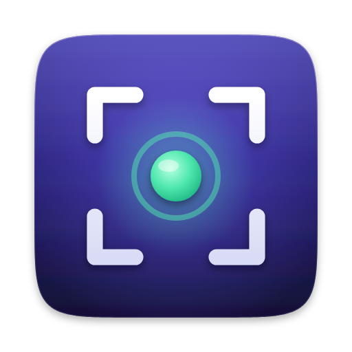

# ShowTake issues

Bug reports, feature requests and release downloads for [ShowTake](https://showtake.app). ShowTake itself is closed
source; this repository holds no code.

- **Report a bug:** in ShowTake choose **Help → Report a Bug…** (it fills in your version and redacted diagnostics),
  or [open an issue](https://github.com/orchestero/showtake-issues/issues/new/choose).
- **Ask for a feature:** [feature request](https://github.com/orchestero/showtake-issues/issues/new?template=feature_request.md).
- **Private or license questions:** support@showtake.app.
- **Downloads:** [showtake.app/download](https://showtake.app/download), Homebrew
  `brew install --cask orchestero/tap/showtake`, or the [releases](https://github.com/orchestero/showtake-issues/releases)
  of this repository.

Your recordings never leave your Mac. Please do not attach clips or logs that contain private data.

## What ShowTake is

ShowTake is a Mac app (macOS 26 Tahoe or later) with a built-in MCP server that films demo videos of your own iOS
(Simulator) and Mac apps. Your coding agent drives the real app; ShowTake logs every tap and renders zooms,
captions, App Store previews, App Store screenshots and social cuts. Recordings never leave your Mac.

## MCP server

ShowTake ships a local MCP server (stdio) inside the app. No package, API key or account is needed. Install
ShowTake (`brew install --cask orchestero/tap/showtake` or [showtake.app/download](https://showtake.app/download)),
then add it to your agent:

    claude mcp add --scope user showtake -- "/Applications/ShowTake.app/Contents/MacOS/showtake-mcp"

Any MCP client works:

```json
{
  "mcpServers": {
    "showtake": {
      "command": "/Applications/ShowTake.app/Contents/MacOS/showtake-mcp",
      "args": []
    }
  }
}
```

Codex: `codex mcp add showtake -- "/Applications/ShowTake.app/Contents/MacOS/showtake-mcp"`
Gemini CLI: `gemini mcp add --scope user showtake "/Applications/ShowTake.app/Contents/MacOS/showtake-mcp"`
Claude Code plugin: [orchestero/showtake-claude-plugin](https://github.com/orchestero/showtake-claude-plugin)

### Tools

| Tool | What it does |
| --- | --- |
| `list_targets` | Xcode projects/schemes in the working directory, simulators, Mac apps |
| `prepare_ios` | Build the app, clone a clean Simulator (9:41 status bar, locale, appearance), install, launch |
| `prepare_macos` | Launch a Mac app, size its window, check Accessibility and Screen Recording permissions |
| `launch_app` | Relaunch the prepared app (optionally with fresh data) |
| `observe` | Compact accessibility tree of the current screen |
| `tap` / `type_text` / `swipe` / `scroll` / `press` | Drive the app, each with an optional on-screen caption |
| `wait_for` | Wait for an element to appear or disappear |
| `mark` | Manual caption / emphasis marker |
| `start_take` / `end_take` | Record a take; `end_take` judges it clean or lists issues |
| `save_flow` / `replay_flow` / `retake` | Save a take as a flow and re-shoot it without an LLM |
| `render` | Plan the video: cut, zooms, captions, per-preset checks |
| `export` | Write MP4s (App Previews, header, social) with validation, plus screenshots |
| `screenshot` | Live screenshot or App Store screenshots from a take |
| `import_video` | Turn your own screen recording into a take with zooms |
| `doctor` | System check with the exact fix for each problem |
| `license_status` / `update_status` | Plan, seats, version and update state |
| `upgrade` | Returns a checkout link; after payment the app activates itself |

Resource: `showtake://guide` (agent guide). Prompt: `film_demo`.
Docs: [MCP setup](https://showtake.app/docs/mcp-setup) · [Tools reference](https://showtake.app/docs/tools) ·
[Agent playbook](https://showtake.app/agents.md)

## License

ShowTake is proprietary software with a free tier; see [LICENSE](LICENSE) and the
[terms](https://showtake.app/terms).
